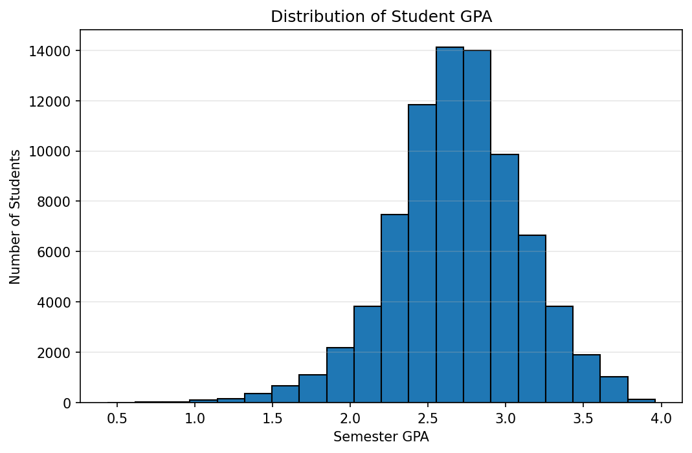
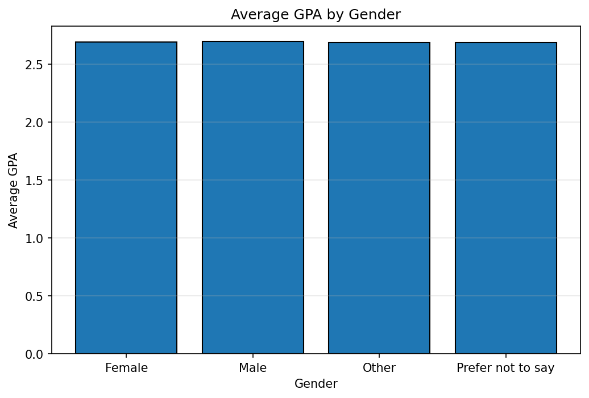
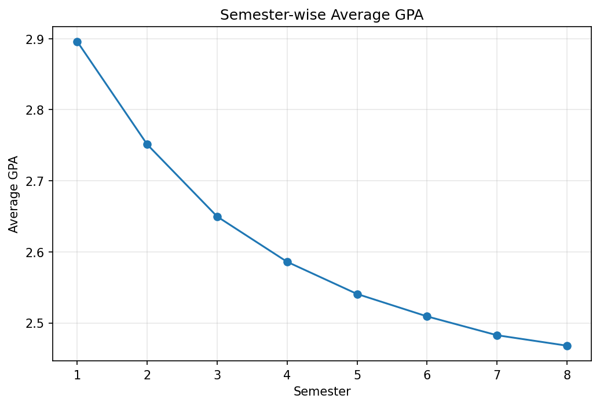
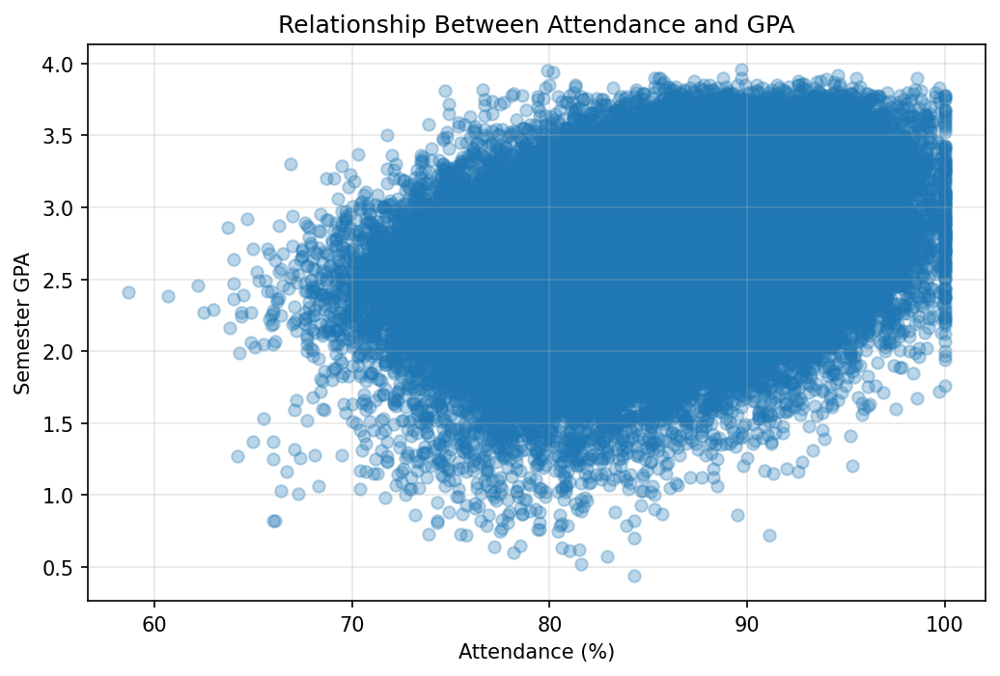
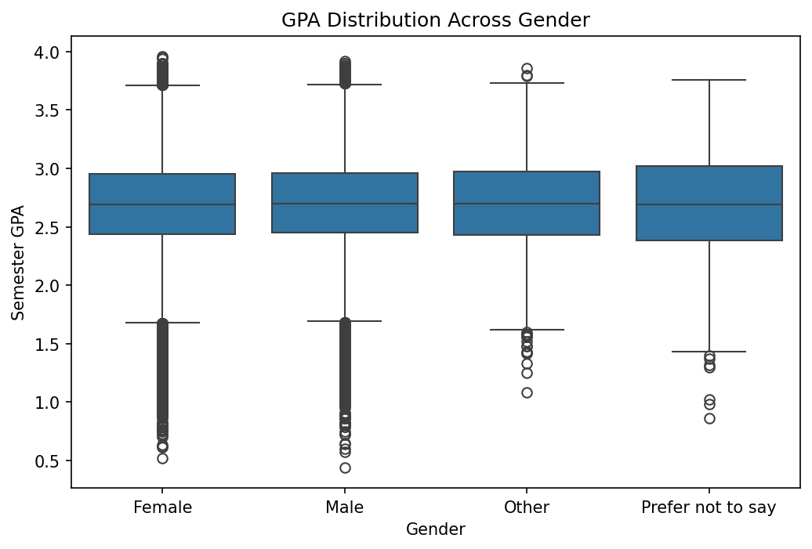
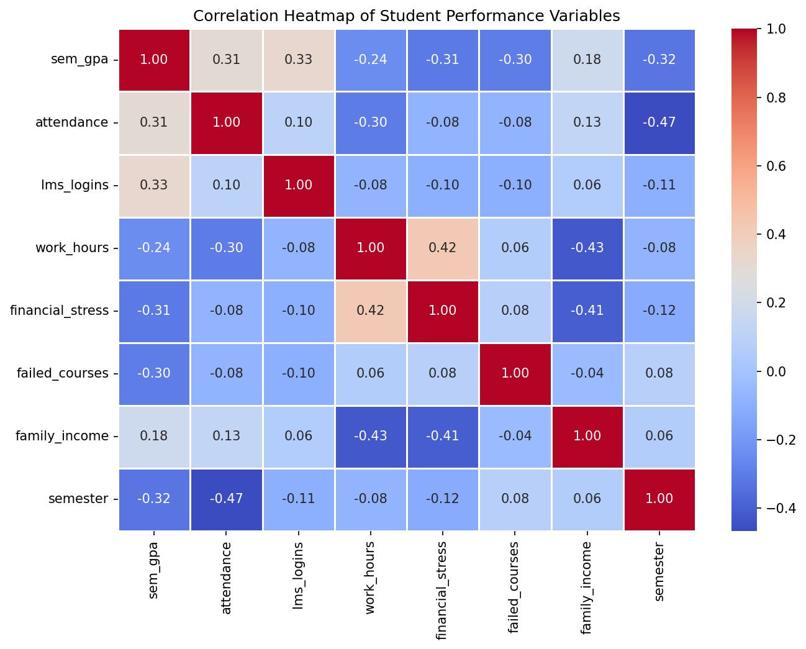

# student-performance-analysis
Data preparation, EDA, visualization and feature engineering on a synthetic student retention dataset using Python (NumPy, Pandas, Matplotlib, Plotly).
# Student Performance Analysis

This project analyses a longitudinal, synthetic student dataset to understand how attendance, engagement, finances and semester progression relate to academic performance (semester GPA) and student dropout. It was completed for the M.Tech CSE (Artificial Intelligence) practical assignment "Data Preparation and Analysis" (MTAI-PE1-20) at CDAC Mohali, and covers NumPy, Pandas, Matplotlib, Plotly, Exploratory Data Analysis (EDA) and feature engineering.

## Dataset

- **Name:** Student Retention & Academic Performance Data (`academic_survival_longitudinal.csv`)
- **Source:** https://www.kaggle.com/datasets/razanihababdellatif/student-retention-and-academic-performance-data
- **License:** CC0 1.0 Universal (Public Domain)
- **Type:** Synthetic (computer-generated) data that mimics a real student information system, with intentional missing values and inconsistent labels for cleaning practice
- **Size:** 79,239 records, 22 columns, 20,000 unique students, up to 8 semesters each
- **Contents:** demographics, family finances, GPA, attendance, LMS logins, advising visits, failed courses, financial stress and dropout indicators

The dataset is included in the `data/` folder under its CC0 license.

## Problem Statement and Objectives

Student dropout is costly for both students and institutions. The goal of this project is to:

1. Understand the structure and quality of the dataset
2. Clean the data (missing values, duplicates, inconsistent labels and types, outliers)
3. Explore patterns and relationships between GPA, attendance, finances, engagement and dropout
4. Visualise the findings using Matplotlib and Plotly
5. Engineer new features that can be used for later modelling
6. Summarise findings, conclusions and limitations

## Project Workflow

1. **Dataset collection:** Kaggle dataset, problem statement and objectives
2. **NumPy:** array creation, indexing, slicing, arithmetic, and statistics (mean, median, standard deviation, min, max, percentiles) on semester GPA
3. **Pandas:** first and last records, shape, column names, data types, summary statistics, missing values and duplicates
4. **Cleaning and preprocessing:**
   - 4,471 missing values imputed (median for numerical, mode for categorical): 3,604 in `Family_Income` and 867 in `LMS_Logins`
   - 249 invalid attendance values (below 0 or above 100) corrected
   - Column names standardised to lowercase with underscores; gender labels unified; data types corrected
   - 0 duplicate records found
   - Outliers detected with the IQR method and retained because they are valid values
   - Before and after cleaning compared
5. **EDA:** descriptive statistics, group comparisons, semester-wise trends and correlation analysis
6. **Matplotlib visualisations:** histogram, bar chart, line chart, scatter plot, box plot and correlation heatmap
7. **Plotly visualisations:** interactive histogram, scatter plot and bar chart with hover information
8. **Feature engineering:**
   - `gpa_category` (Low, Average, Good, Excellent)
   - `attendance_category` (Low, Moderate, High)
   - `academic_risk_score` (0-3, based on low attendance, failed courses and high financial stress)
   - One-hot encoding of categorical columns and standard scaling of numerical columns
9. **Conclusions:** major findings, recommendations and limitations

## Key Findings

- Average semester GPA is 2.69 (standard deviation 0.42) and average attendance is 85.1%.
- Average GPA falls steadily from 2.90 in semester 1 to 2.47 in semester 8.
- The dropout-next-semester rate rises from 6.7% in semester 1 to about 9-10% from semester 3 onward.
- GPA is most positively correlated with LMS logins (0.33) and attendance (0.31), and most negatively with semester (-0.32), financial stress (-0.31), advising visits (-0.30) and failed courses (-0.30).
- Gender and housing status show almost no difference in average GPA.
- Higher family income is linked with lower financial stress (-0.41) and fewer work hours (-0.43).

## Visualisations

### Matplotlib








### Plotly (interactive)

The interactive charts are saved as HTML files in the `images/` folder. Download a file and open it in a browser to zoom, hover and explore.

- `images/plotly_histogram_gpa.html`
- `images/plotly_scatter_attendance_gpa.html`
- `images/plotly_bar_gender_gpa.html`

## Conclusions and Recommendations

1. **Improve learning engagement:** LMS logins show the strongest positive link with GPA, so regular use of online learning resources should be encouraged.
2. **Monitor attendance:** low attendance is associated with lower GPA, so students with falling attendance should receive early support.
3. **Provide academic support:** students with failed courses or a low GPA should receive mentoring and remedial help.
4. **Support students under financial stress:** scholarships, assistance and counselling may help, as financial stress is negatively linked with GPA.
5. **Focus on retention from semester 3 onward,** when dropout rates are highest.

## Limitations

- The data is synthetic, so some relationships reflect rules built into the simulation and may not hold for real students.
- Median/mode imputation may introduce some bias.
- Each student has several records, so records are not fully independent.
- Findings show correlation, not causation.
- Later semesters only include students who stayed enrolled, which may affect the GPA trend.
- Risk-score thresholds and category cut-offs were chosen for this analysis; other choices may give different results.
- Results may not generalise beyond this dataset.

## Repository Structure

```
student-performance-analysis/
├── README.md
├── requirements.txt
├── .gitignore
├── Student_Performance_Analysis.ipynb
├── data/
│   └── academic_survival_longitudinal.csv
└── images/
    └── (Matplotlib PNGs and Plotly HTML files)
```

## Libraries Used

NumPy, Pandas, Matplotlib, Seaborn, Plotly and scikit-learn (see `requirements.txt`).

## How to Run

```bash
git clone https://github.com/Akshi-Pathania/student-performance-analysis.git
cd student-performance-analysis
pip install -r requirements.txt
jupyter notebook Student_Performance_Analysis.ipynb
```

The dataset is already in the `data/` folder. Run all cells from top to bottom. Charts are saved automatically in the `images/` folder.

## Author

Akshi Pathania, M.Tech CSE Artificial Intelligence, CDAC Mohali
GitHub: [Akshi-Pathania](https://github.com/Akshi-Pathania)
